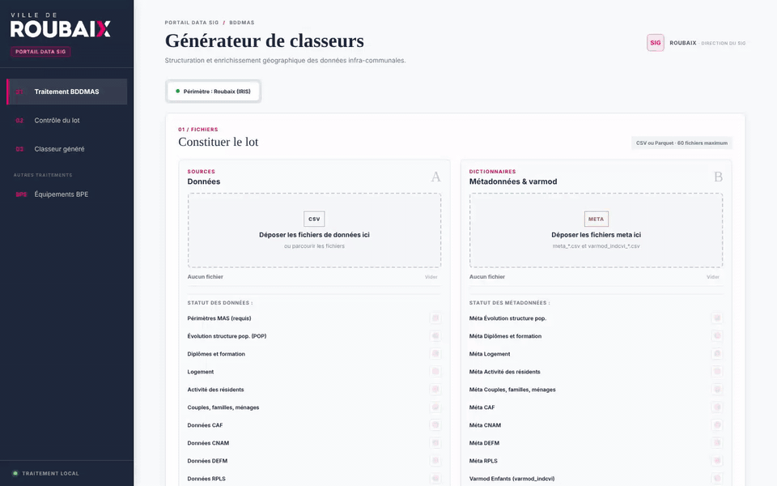
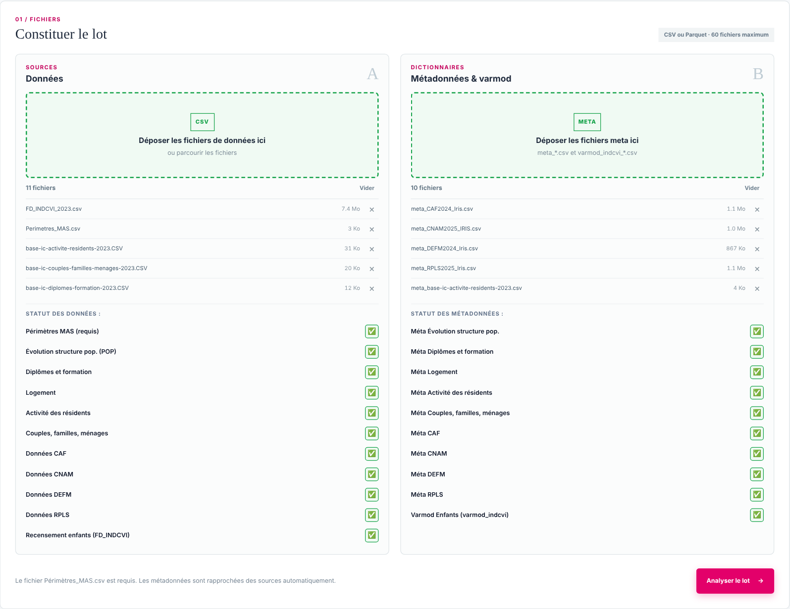
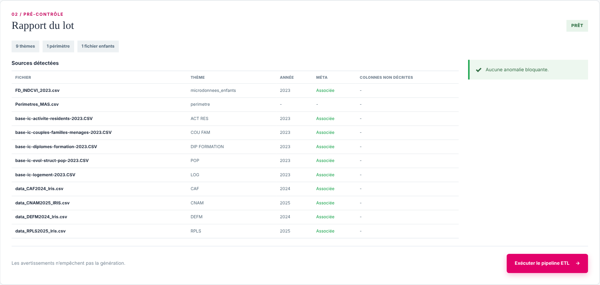
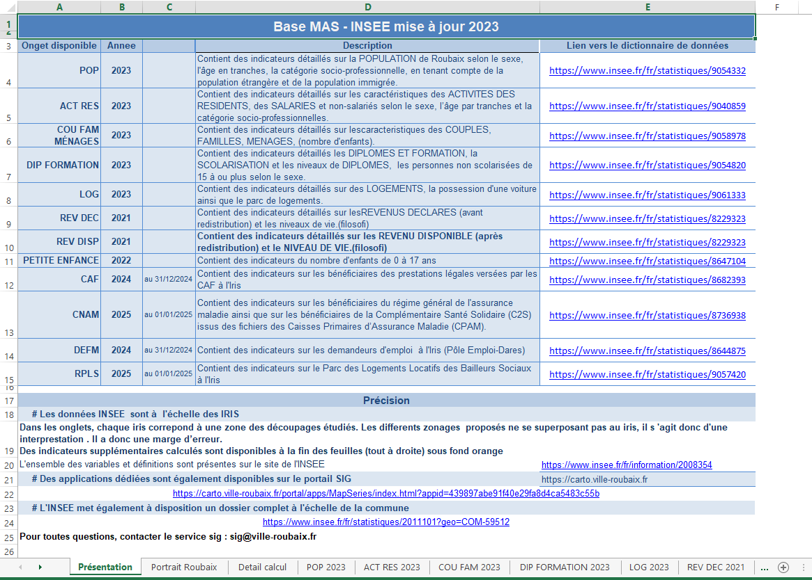
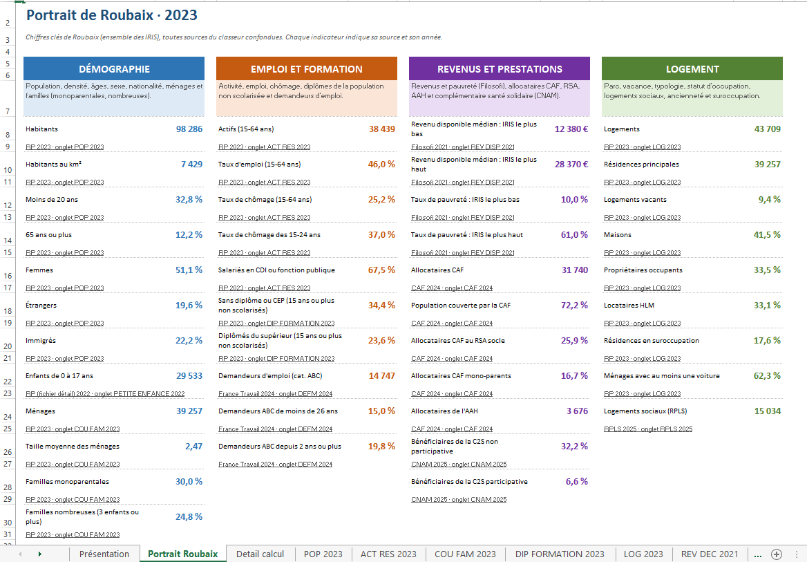
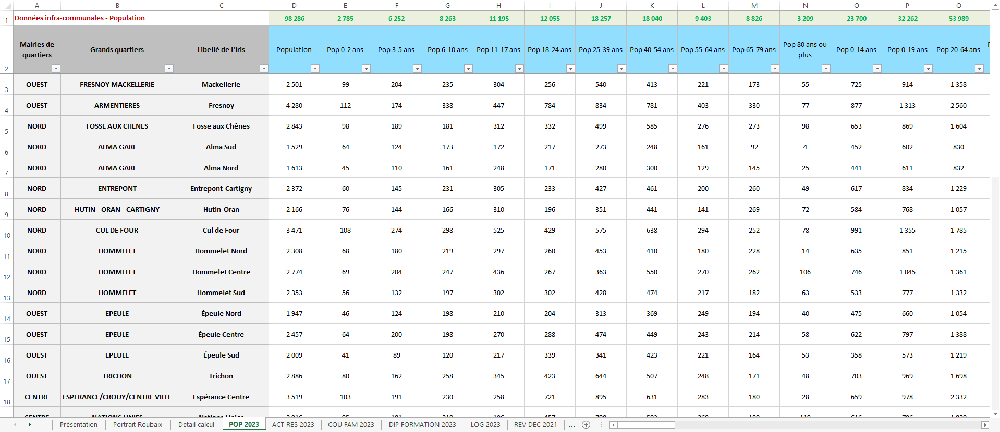
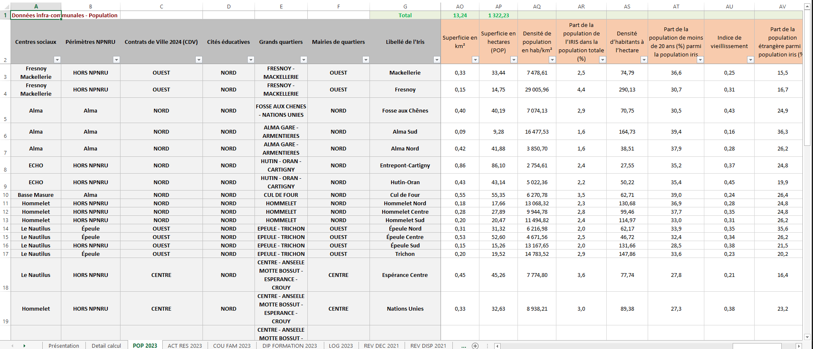

# BDDMAS Roubaix – ApplicationMAJ

**Portail web et pipeline ETL qui transforment les fichiers bruts de l'Insee et de ses partenaires en un classeur Excel prêt à l'emploi sur les 38 IRIS de Roubaix.**


-8A2BE2)



## Le projet en bref

**Le besoin.** Le service SIG de la Ville de Roubaix publie une base de données infra-communale (BDDMAS) : population, emploi, familles, diplômes, logement, revenus, prestations CAF, assurance maladie, demandeurs d'emploi, logement social et petite enfance, quartier par quartier. Chaque mise à jour demandait de récupérer une dizaine de fichiers aux formats différents, de filtrer Roubaix, de recalculer des dizaines d'indicateurs et de reporter le tout dans un classeur Excel d'une quinzaine d'onglets, avec de nombreuses manipulations manuelles.

**La solution.** Un portail web local : on dépose les fichiers, l'application contrôle le lot, puis génère le classeur complet (valeurs, indicateurs calculés, mise en forme, pages de présentation, portrait de la ville) en moins d'une minute.

**Ce qui le rend robuste.**
- Fonctionne d'un millésime à l'autre (recensements 2022 et 2023, formats Insee différents) sans toucher au code.
- Quand l'Insee renomme ou ajoute des variables, un module les rattache seul aux bonnes colonnes (règles, puis IA facultative), avec un cache relisible et corrigeable.
- Un pré-contrôle bloque les lots incomplets avant tout calcul (fichiers manquants, métadonnées absentes, IRIS manquants, doublons de millésime).
- Données acceptées en CSV ou en Parquet.

## Aperçu

### 1. Dépôt du lot

Les fichiers sont glissés dans deux zones (données, métadonnées). Le statut de chaque source attendue s'affiche aussitôt.



### 2. Pré-contrôle

Avant tout calcul, l'application vérifie le lot : thème et millésime reconnus, métadonnée associée, colonnes non documentées, IRIS manquants. Une erreur bloquante empêche la génération.



### 3. Classeur généré

La page **Présentation** est générée selon le lot : millésime de chaque source et lien vers sa documentation Insee.



Juste après, l'onglet **Portrait Roubaix** donne les chiffres clés de la ville en quatre blocs (démographie, emploi et formation, revenus et prestations, logement). Chaque valeur est une formule Excel qui pointe vers les onglets thématiques : un effectif est la somme des IRIS, une part est une somme divisée par une somme, et les indicateurs Filosofi affichent l'IRIS le plus bas et le plus haut. Un lien renvoie vers l'onglet source.



Chaque onglet thématique contient une ligne par IRIS. Trois colonnes grises situent l'IRIS : **Mairies de quartiers**, **Grands quartiers** (noms issus de `dictionnaires/grand_quartier.yml`) et **Libellé de l'Iris** (libellé Insee). Les en-têtes bleus sont les effectifs (avec ligne Total), les orange les indicateurs (taux, densités, indices), regroupés à droite. La mise en page est aérée : cellules centrées, lignes d'IRIS à 30 pt, colonnes dimensionnées selon leur contenu.





## Comment ça marche


| Couche | Technologies |
|---|---|
| Portail | FastAPI, Uvicorn, HTML/CSS/JavaScript sans framework |
| Traitement | pandas, NumPy, DuckDB (Parquet), PyYAML |
| Sortie | openpyxl (remplissage du modèle, formats, tableaux structurés, sous-totaux) |
| IA (facultative) | API compatible OpenAI : Groq, Mistral, Gemini ou Ollama en local |
| Exports (ligne de commande) | CSV pour SIG, base SQL via SQLAlchemy |

## Points techniques

- **Configuration plutôt que code** : correspondances de fichiers, formules des indicateurs, titres des onglets et liens Insee sont dans des fichiers YAML (`dictionnaires/`). Un nouveau millésime se gère en ajoutant une ligne.
- **Colonnes d'un nouveau millésime** (`modules/colonnes_auto.py`) : correspondance exacte, puis approchée (mêmes nombres, mêmes mots sensibles comme hommes et femmes), puis un appel IA par onglet avec réponse JSON validée et seuil de confiance. L'IA ne touche jamais aux valeurs ; sans clé ou sans réseau, le pipeline continue sans elle.
- **Convertisseur des cubes Insee 2023** (format long SDMX vers format large), avec contrôle de cohérence (population = hommes + femmes, logements = résidences principales + secondaires + vacants…).
- **Référentiel des quartiers** : les noms des grands quartiers et les secteurs de mairie sont tenus dans des YAML (`grand_quartier.yml`, `secteurs_mairie.yml`) ; le pré-contrôle signale tout IRIS absent de `grand_quartier.yml`.
- **Arrondi contrôlé** : les effectifs additifs sont arrondis par la méthode du plus fort reste, pour que la somme des 38 IRIS égale le total communal officiel (98 286 habitants en 2023).
- **Mise en page réglable** : largeurs de colonnes, hauteur des lignes et nombre de lignes d'en-tête sont des constantes en tête de `modules/mise_en_page.py` (voir [Régler la mise en page](#régler-la-mise-en-page)).
- **Petite enfance** : effectifs par âge estimés depuis le fichier détail du recensement (pondération `IPONDI`), lu par blocs.
- **Non-régression** : chaque évolution est vérifiée en comparant le classeur produit à la version validée, cellule par cellule.

## Auteur

Réalisé par Bilal ([@Twweetyy](https://github.com/Twweetyy)) en alternance au service SIG de la Ville de Roubaix (2026-2027).

---

*La suite est le guide complet : installation, lancement, constitution d'un lot et fonctionnement détaillé du pipeline.*

Le projet contient :
- un pipeline (`main_bddmas.py`) utilisable en ligne de commande ou depuis une application ;
- un portail web local (FastAPI / `uvicorn`) pour déposer un lot de fichiers et télécharger le classeur ;
- un convertisseur des cubes Insee du recensement, valable pour 2023 et les millésimes suivants (`scripts/transformer_recensement.py`) ;
- un guide pour intégrer un nouveau millésime sans toucher au code ([`doc/nouveau_millesime.md`](doc/nouveau_millesime.md)) ;
- un module qui rattache automatiquement les colonnes inconnues d'un nouveau millésime Insee (`modules/colonnes_auto.py`, IA facultative) ;
- des lots d'exemple 2022 et 2023 (`exemples/`, avec RPLS 2025) pour essayer le portail tout de suite ;
- le dernier classeur généré, `TAB_BDDMAS_INSEE2023.xlsx`, à la racine.

Le pipeline fonctionne avec le recensement 2022 (fichiers Insee au format large) et avec le recensement 2023 (cubes Insee au format long, convertis au préalable).
## Essayer en 2 minutes

1. Installer (voir plus bas), puis double-cliquer sur `run_portal.bat`.
2. Zone **Données** : déposer les fichiers de `exemples/lot2023/data/`.
3. Zone **Métadonnées** : déposer les fichiers de `exemples/lot2023/meta/`.
4. **Analyser le lot**, puis **Exécuter le pipeline ETL**, et télécharger le classeur.

Détails dans `exemples/README.md`.

## Architecture

```text
ApplicationMAJ/
├─ .venv/                          Environnement virtuel (non versionné)
├─ data/                           Fichiers CSV bruts et référentiel des périmètres (ignoré par Git)
│  ├─ data2023/                    CSV 2023 transformés
│  │  └─ sources_brutes_insee/     Cubes Insee 2023 bruts
│  └─ indcvi_roubaix/              FD_INDCVI filtré sur Roubaix
├─ dictionnaires/                  Correspondances de fichiers, variables et onglets (YAML)
│  ├─ millesimes_valides.yml       Dernier millésime validé à la main, par thème
│  ├─ grand_quartier.yml           Nom du grand quartier de chaque IRIS (colonne « Grands quartiers »)
│  ├─ secteurs_mairie.yml          Secteur de mairie de chaque IRIS
│  ├─ superficies_iris_roubaix.yml Superficie de chaque IRIS (densités)
│  ├─ liens_presentation.yml       Liens vers la documentation Insee de chaque source
│  ├─ correspondances_auto.yml     Décisions du module colonnes (généré, corrigeable)
│  └─ meta/                        Métadonnées meta_*.csv (dont meta2023/ généré)
├─ modules/
│  ├─ socle_geo.py                 Chargement du référentiel MAS, superficies et jointures
│  ├─ ingestion.py                 Pré-contrôle, lecture, nettoyage et renommage des sources thématiques
│  ├─ lecture.py                   Lecture des données en CSV (pandas) ou Parquet (DuckDB)
│  ├─ indicateurs.py               Calculs dérivés, arrondis et répartitions pondérées des enfants
│  ├─ export_excel.py              Remplissage du modèle et mise en forme Excel
│  ├─ mise_en_page.py              Formats, largeurs, hauteurs, centrage, ligne Total, ordre des colonnes
│  ├─ pages_info.py                Pages Présentation et Détail calcul générées selon le lot
│  ├─ portrait_roubaix.py          Onglet Portrait Roubaix (chiffres clés en formules Excel)
│  ├─ colonnes_auto.py             Colonnes inconnues d'un nouveau millésime (sans IA puis IA, cache YAML)
│  ├─ llm_wrapper.py               Appel d'un modèle compatible OpenAI (Groq, Mistral, Ollama…)
│  ├─ export_sig.py                Export des tables attributaires CSV pour les SIG
│  └─ persistence.py               Insertion SQLAlchemy configurable
├─ scripts/
│  ├─ transformer_recensement.py   Conversion des cubes Insee (2023 et suivants)
│  ├─ extraire_indcvi_roubaix.py   Extraction des lignes Roubaix du FD_INDCVI
│  ├─ simuler_nouveau_millesime.py Faux millésime +1 pour tester colonnes_auto
│  └─ diag.py                      Diagnostic des cubes Insee 2023
├─ exemples/                       Lots 2022 et 2023 prêts à déposer dans le portail
├─ web/                            Front du portail (index.html, multi-upload.js, styles.css)
├─ projets_annexes/               Mini-projets qui exploitent le classeur produit (voir plus bas)
├─ doc/img/                        Captures et démonstration utilisées dans ce README
├─ exports_sig/                    Exportations SIG (ignoré par Git)
├─ main_bddmas.py                  Orchestrateur du pipeline
├─ webapp.py                       API FastAPI du portail
├─ run_portal.bat                  Lanceur du portail (double-clic)
├─ run_portal.py                   Démarrage du serveur Uvicorn
├─ Dockerfile                      Recette de l'image Docker du portail
├─ docker-compose.yml              Lancement du portail avec Docker (port, .env, dossiers partagés)
├─ .env.example                    Modèle de configuration de l'IA (copier en .env)
├─ TAB_BDDMAS_INSEE2022_MODELE.xlsx  Classeur modèle conservé comme gabarit
├─ TAB_BDDMAS_INSEE2023.xlsx       Dernier classeur généré (lot 2023)
├─ requirements.txt                Dépendances Python
└─ README.md                       Vous êtes ici
```

## Installation

Prérequis : Python 3.11 ou plus récent. Depuis le dossier du projet :

```powershell
python -m pip install -r requirements.txt
```

Optionnel (IA du module colonnes) : copier `.env.example` en `.env` et renseigner la clé. Sans `.env`, ou avec `BDDMAS_LLM=0`, le pipeline fonctionne sans IA.

## Lancement

### Portail web (usage courant)

```bat
run_portal.bat
```
- Le script active le virtualenv (`.venv`).
- Il lance `run_portal.py`, qui démarre le serveur Uvicorn sur `http://127.0.0.1:5000`.
- Le navigateur s'ouvre automatiquement sur l'URL du portail.
- Pour arrêter le serveur, appuyez sur `Ctrl+C`.
- Le message « Les chemins d'accès UNC ne sont pas pris en charge » au démarrage est sans conséquence.
- Après une modification du code, fermez l'ancien serveur avant de relancer, puis faites `Ctrl+F5` dans le navigateur.

Lancement manuel équivalent :

```powershell
python -m uvicorn webapp:app --host 127.0.0.1 --port 8000
```
puis ouvrir `http://127.0.0.1:8000`.

L'interface affiche le pré-contrôle avant d'autoriser la génération. Les jobs sont isolés dans le répertoire temporaire du système (`%TEMP%\bddmas-web-jobs`) et nettoyés après 12 heures. Les exports SIG et SQL ne sont pas produits par l'interface.

### Portail web avec Docker (sans Python ni `.venv`)

Prérequis : [Docker Desktop](https://www.docker.com/products/docker-desktop/) installé et démarré. Depuis le dossier du projet :

```powershell
docker compose up --build
```
puis ouvrir `http://localhost:5000`.

- Le premier lancement construit l'image (quelques minutes) ; les suivants démarrent en quelques secondes.
- Au démarrage, `scripts/transformer_recensement.py` convertit les cubes Insee présents dans `data/`, comme `run_portal.bat`.
- `data/` et `dictionnaires/meta/` sont partagés avec le PC : les fichiers déposés et les métadonnées produites restent dans le dossier du projet.
- Le `.env` est lu s'il existe (IA du module colonnes) ; il n'est jamais copié dans l'image.
- Pour arrêter : `Ctrl+C`, ou `docker compose down` si le portail a été lancé en arrière-plan avec `docker compose up -d`.
- Après une modification du code, relancer `docker compose up --build` pour reconstruire l'image.

### Pipeline en ligne de commande

```powershell
python main_bddmas.py
```
Les sources sont lues dans `data/` et les métadonnées dans `dictionnaires/meta/`. Le classeur `TAB_BDDMAS_INSEE2022_Tout_perimetre.xlsx` est généré à la racine à partir de `TAB_BDDMAS_INSEE2022_MODELE.xlsx`. Le modèle d'origine n'est pas modifié. Les exports SIG et l'insertion SQL sont produits en plus (voir plus bas).

Pendant l'exécution, `tqdm` affiche la progression des étapes du pipeline, la lecture du recensement et l'écriture des lignes Excel. Pour le recensement, le nombre de lignes et le temps restant sont estimés à partir des 2 premiers Mo du fichier ; cette estimation est indicative.

## Constituer un lot (portail)

**Zone A – Données**
- `Perimetres_MAS.csv` (obligatoire)
- Recensement : `base-ic-evol-struct-pop-AAAA.CSV`, `base-ic-activite-residents-AAAA.CSV`, `base-ic-couples-familles-menages-AAAA.CSV`, `base-ic-diplomes-formation-AAAA.CSV`, `base-ic-logement-AAAA.CSV`
- Filosofi : `BASE_TD_FILO_IRIS_AAAA_DEC.csv`, `BASE_TD_FILO_IRIS_AAAA_DISP.csv`
- `data_CAF…`, `data_CNAM…`, `data_DEFM…`, `data_RPLS…`
- `FD_INDCVI_AAAA.csv` (version filtrée Roubaix, voir plus bas)

**Zone B – Métadonnées**
- Un `meta_<nom du fichier>.csv` par fichier de données, et `varmod_indcvi_AAAA.csv`.
- Obligatoire : le portail n'utilise pas le dossier `dictionnaires/meta` du disque.

**Formats acceptés**
- Données : CSV ou Parquet (`.parquet`), au choix pour chaque fichier. Un lot peut mélanger les deux (ex. recensement en Parquet, CAF en CSV). Le nom du fichier suit les mêmes règles, seule l'extension change : `base-ic-logement-2023.parquet`, `Périmètres_MAS.parquet`, `FD_INDCVI_2022.parquet`…
- Un Parquet doit contenir les mêmes colonnes que le CSV équivalent. Les colonnes peuvent y être typées (nombres) ou en texte : le résultat est identique.
- Métadonnées : CSV uniquement.
- Les Parquet sont lus avec DuckDB (`modules/lecture.py`). Pour le FD_INDCVI, seules les 4 colonnes utiles sont lues et la progression affiche le nombre exact de lignes.

**Règles**
- Un seul fichier par thème dans un lot (ex. pas de POP 2022 et POP 2023 ensemble : erreur bloquante `versions_multiples_theme`).
- Les années peuvent différer d'un thème à l'autre (recensement 2023 + Filosofi 2021 + CAF 2024…).
- Le classeur ne contient que ce qui est déposé : un onglet sans fichier dans le lot reste vide.

## Fichiers d'entrée

- `Perimetres_MAS.csv` est le référentiel géographique requis. Il doit contenir au minimum `IRIS` et les colonnes de périmètre utilisées par `modules/socle_geo.py` (`Quartier`, `Grands_quartiers`, `Libellé_IRIS`…). La colonne `Grands_quartiers` suit les noms de `dictionnaires/grand_quartier.yml`. Seules trois colonnes de zonage sont reprises dans le classeur (voir plus bas) ; les autres (centres sociaux, NPNRU, contrats de ville…) restent dans les exports SIG et SQL.
- Les CSV thématiques Insee, FILO, CAF, CNAM, DEFM et RPLS : le nom du fichier doit correspondre à une entrée de `dictionnaires/files_names.yml` ; les fichiers non mappés sont signalés par le pré-contrôle.
- Les métadonnées `meta_*.csv` sont appariées par nom normalisé (année ignorée). Les colonnes `COD_VAR` et `LIB_VAR` fournissent les libellés ; les modalités textuelles sont traduites à partir de `COD_MOD` et `LIB_MOD` lorsqu'elles existent. Les dictionnaires YAML restent utilisés en complément ou en repli.
- Le fichier individuel du recensement commence par `FD_INDCVI_` et doit contenir `IRIS`, `AGEREV`, `AGED` et `IPONDI`. La méta `varmod_indcvi_AAAA.csv` documente ces champs. Seules les colonnes requises sont lues, par blocs.
- `dictionnaires/superficies_iris_roubaix.yml` fournit les superficies par code IRIS, utilisées pour les densités et superficies calculées.
  
## Recensement (2023 et suivants) : préparation des données

Depuis 2023, les fichiers Insee sont des cubes au format long (`GEO`, `SEX`, `AGE`, `RP_MEASURE`, `OBS_VALUE`…). Ils doivent être convertis avant d'être utilisés.

1. Placer les cubes bruts dans `data/dataAAAA/sources_brutes_insee/` (AAAA = millésime) : `base-ic-pop-AAAA.csv`, `base-ic-log-AAAA.csv`, `base-ic-emp-AAAA.csv`, `base-ic-men-AAAA.csv`, `base-ic-dip-AAAA.csv`. Chaque cube peut aussi être fourni en Parquet (`base-ic-pop-AAAA.parquet`…), environ 10 fois plus léger : si les deux formats sont présents, le Parquet est utilisé.
2. `run_portal.bat` lance la conversion à chaque démarrage, pour tous les millésimes trouvés. À la main :
   ```powershell
   python scripts/transformer_recensement.py            # tous les millésimes présents
   python scripts/transformer_recensement.py --annee 2024
   python scripts/transformer_recensement.py --force    # régénère même si les sorties sont à jour
   ```
3. Le script écrit les 5 CSV au format large dans `data/dataAAAA/` (`base-ic-evol-struct-pop-AAAA.CSV`, etc.) et leurs métadonnées dans `dictionnaires/meta/metaAAAA/`. Les codes de variables portent l'année du millésime (`P24_POP`, `C24_MEN`…).
4. Vérifier le bloc « Contrôle de cohérence » affiché en fin d'exécution : Population = Hommes + Femmes, Logements = RP + résidences secondaires + vacants, etc.

Points clés du transformer :
- `valeur_cube` ramène à `_T` toute dimension non citée dans un filtre, pour éviter le double comptage.
- Chaque thème fixe sa mesure (`RP_MEASURE`) : `DWELLINGS` pour le logement, `POP` pour les autres.
- Le nombre de ménages (COU FAM) est repris des résidences principales du cube logement, le cube ménages n'ayant pas de mesure « ménages ».
- Pas de tranche 25-29 ans dans le cube 2023 : `Pop 15-29 ans` est remplacée par `Pop 15-24 ans`.
- Si l'Insee change les codes des dimensions, le script s'arrête (« Population nulle ») ou signale les colonnes à 0 : voir [`doc/nouveau_millesime.md`](doc/nouveau_millesime.md), section 3.

Ne plus utiliser `adapt_2023_transform.py` (renommé en `.bak`) : il écrivait les cubes bruts sous les mêmes noms et écrasait les fichiers transformés.

## Fichier enfants FD_INDCVI (portail)

Le fichier national (~4 Go) sature le disque C: lors de l'envoi au portail, qui le copie dans `%TEMP%`. Il faut en extraire une fois les lignes de Roubaix :

```powershell
python scripts/extraire_indcvi_roubaix.py "chemin\vers\FD_INDCVI_AAAA.csv"
```
- Le fichier national peut être en CSV ou en Parquet.
- Sortie : `data/indcvi_roubaix/FD_INDCVI_AAAA.csv` (quelques Mo), même nom et mêmes colonnes que l'original. Aucune modification du pipeline n'est nécessaire.
- En cas d'erreur `No space left on device`, vider `%TEMP%\bddmas-web-jobs`.

## Dictionnaires

- `files_names.yml` : motif de nom de fichier → thème, au format `motif: THÈME` (ex. `base-ic-evol-struct-pop: POP`). L'année est ignorée lors de la comparaison : une même entrée sert pour 2022 et 2023.
- `calculated_columns.yml` : indicateurs calculés. Les références à `POP 2022`, `ACT RES 2022`… sont résolues automatiquement vers l'année présente dans le lot (`modules/indicateurs.py`, `_resoudre_table`).
- `info_pages.yml` : titres des onglets Excel.
- `dictionnaire_variables*.yml` : libellés de repli des variables.

## Étapes du pipeline

Avant les étapes ci-dessous, `analyser_fichiers_entree` vérifie les sources, les métadonnées, les clés géographiques et les doublons de millésime. Le résultat structuré est disponible pour une interface ; les erreurs bloquantes arrêtent le pipeline avant les calculs.

1. `modules/ingestion.py` identifie les CSV thématiques mappés, les nettoie, filtre Roubaix lorsque la source possède une colonne `IRIS` ou `COM`, puis traduit les variables. Chaque table est nommée `THÈME ANNÉE` (ex. `POP 2023`), l'année étant lue dans le nom du fichier.
2. Le recensement enfants est lu par blocs. `modules/indicateurs.py` filtre les codes IRIS commençant par `59512`, sélectionne les âges inférieurs à 18 ans et additionne le poids `IPONDI` par IRIS et par âge.
3. Deux répartitions sont produites : âge révolu (`AGEREV`) et âge au millésime (`AGED`). Elles alimentent les onglets `PETITE ENFANCE {année du FD_INDCVI}` et `PETITE ENFANCE MILLÉSIME`, avec les colonnes `Age : 0` à `Age : 17`. Les effectifs sont des estimations pondérées de l'échantillon du recensement. La colonne `Crèches` du modèle est retirée tant qu'aucune source de crèches n'est configurée.
4. `modules/socle_geo.py` rattache le référentiel `Perimetres_MAS.csv` et les superficies par IRIS. Les indicateurs configurés dans `calculated_columns.yml` sont ensuite calculés.
5. `modules/indicateurs.py` applique les règles de `r_gles_d_arrondis_compl_tes.md` à toutes les colonnes : volumes à l'entier (arrondi contrôlé pour les effectifs additifs : la somme des IRIS égale le total communal officiel, ex. 98 286 habitants en 2023 ; arrondi simple, demis vers le haut, pour les autres), parts/taux à 1 décimale, indices/densités/moyennes/superficies à 2 décimales, variables RPLS `TX…` et `…LOY` à 2 décimales. Les identifiants et libellés restent textuels ; toute autre colonne numérique est arrondie à l'entier.
6. `modules/export_excel.py` remplit les onglets du classeur modèle en conservant leurs en-têtes et leur mise en forme, et écrit les formules de sous-totaux adaptées au nombre de lignes. Les onglets de données du modèle sont vidés avant écriture. Les colonnes du modèle absentes du lot sont supprimées sans laisser de colonnes vides ; les variables nouvelles sont insérées avant `Superficie en km²`, avec le style des colonnes de données. `modules/mise_en_page.py` applique ensuite les formats, largeurs et hauteurs, et `modules/portrait_roubaix.py` ajoute l'onglet Portrait Roubaix après la Présentation.
7. `modules/export_sig.py` crée un CSV par thème dans `exports_sig/`, avec `IRIS` en première colonne sur 9 caractères. Ces exports contiennent des attributs à joindre aux couches IRIS existantes, sans géométrie. (Ligne de commande uniquement.)
8. `modules/persistence.py` insère les tables dans la base configurée uniquement si `BDDMAS_DATABASE_URL` est définie. (Ligne de commande uniquement.)

## Colonnes de zonage et quartiers

Chaque onglet thématique commence par trois colonnes grises, dans cet ordre :

| Colonne | Origine |
|---|---|
| Mairies de quartiers | colonne `Quartier` de `Périmètres_MAS.csv` |
| Grands quartiers | colonne `Grands_quartiers` de `Périmètres_MAS.csv`, alignée sur `dictionnaires/grand_quartier.yml` |
| Libellé de l'Iris | libellé Insee de l'IRIS |

Pour renommer un quartier ou rattacher un IRIS à un autre, modifier `grand_quartier.yml` et la colonne `Grands_quartiers` de `Périmètres_MAS.csv`. La liste des colonnes conservées est `COLONNES_ZONAGE` dans `modules/export_excel.py`.

## Régler la mise en page

Les réglages sont des constantes en tête de `modules/mise_en_page.py` ; il suffit de les modifier puis de régénérer le classeur.

| Constante | Valeur | Effet |
|---|---|---|
| `LARGEUR_MIN`, `LARGEUR_MAX` | 14, 34 | Largeur des colonnes de données |
| `LARGEUR_TEXTE_MAX` | 45 | Largeur maximale d'une colonne de texte |
| `LARGEUR_GEO_MIN`, `LARGEUR_GEO_MAX` | 12, 34 | Largeur des colonnes grises de zonage |
| `LIGNES_ENTETE_MAX` | 4 | Nombre de lignes maximal d'un en-tête avant d'élargir la colonne |
| `HAUTEUR_LIGNE` | 30 | Hauteur des lignes d'IRIS, en points |
| `LIGNES_TEXTE_MAX` | 2 | Une colonne de texte s'élargit (jusqu'à `LARGEUR_TEXTE_MAX`) pour que ses valeurs tiennent sur ce nombre de lignes ; les onglets à colonnes de texte (REV DEC, REV DISP) gardent une hauteur automatique |

Les cellules des IRIS sont centrées. Sur la ligne Total, seules les colonnes additives (effectifs, superficie) reçoivent une somme ; les taux, médianes et indicateurs Filosofi restent sans total.

## Nouveau millésime : colonnes inconnues

Quand l'Insee renomme ou ajoute des variables (fichiers 2024, 2025…), `modules/colonnes_auto.py` décide seul où les placer dans le classeur, sans intervention manuelle.

- **Quand** : seulement pour un fichier plus récent que le millésime validé de son thème (`dictionnaires/millesimes_valides.yml`). Les lots 2022 et 2023, vérifiés à la main, ne sont jamais modifiés.
- **Comment**, dans l'ordre : correspondance exacte, cache des décisions passées, correspondance approchée (libellés quasi identiques), puis IA si elle est configurée. Une décision peu sûre laisse la colonne sous son libellé source, marquée « non résolue ».
- **Où voir** : tableau « Colonnes auto » dans le portail après génération, et avertissement dans le rapport.
- **Corriger** : dans `dictionnaires/correspondances_auto.yml`, changer `entete` puis mettre `methode: manuel`. L'entrée ne sera plus jamais recalculée.
- **Tester** : `python scripts/simuler_nouveau_millesime.py --lot <dossier du lot 2023>` fabrique un faux lot 2024 (codes renommés, libellés reformulés) et écrit le classeur et `decisions.json` dans `sorties/simulation/`, sans toucher au dépôt.

Configuration de l'IA (`.env`, jamais versionné) : `OPENAI_API_KEY`, `OPENAI_BASE_URL`, `OPENAI_MODEL` (tout fournisseur compatible OpenAI : Groq, Mistral, Gemini, Ollama en local), `BDDMAS_LLM` (0 pour désactiver), `BDDMAS_LLM_CONFIANCE_MIN` (0,8 par défaut).

## Utilisation depuis une application

Le traitement est exposé par `executer_pipeline`. Une application peut fournir un dossier de dépôt et un chemin de résultat sans modifier les constantes du lanceur local :

```python
from main_bddmas import ErreurPrecontrole, executer_pipeline

try:
    resultat = executer_pipeline(
        dossier_data="job/data",
        dossier_dicos="dictionnaires",
        chemin_sortie="job/TAB_BDDMAS_Tout_perimetre.xlsx",
        chemin_modele="TAB_BDDMAS_INSEE2022_MODELE.xlsx",
        dossier_export_sig=None,
        persister_sql=False,
        afficher_progression=False,
    )
except ErreurPrecontrole as erreur:
    rapport = erreur.rapport
```

Le rapport de pré-contrôle est également renvoyé dans `resultat["precontrole"]`. `dossier_export_sig=None` et `persister_sql=False` désactivent ces sorties, ce qui convient à une génération web isolée. Le périmètre est fourni dans `dossier_data` ; les chemins du modèle, des superficies, des calculs et des titres peuvent être surchargés si besoin.

## Projets annexes

Le dossier `projets_annexes/` regroupe deux mini-projets qui partent du classeur `TAB_BDDMAS_Tout_perimetre_<ANNEE>.xlsx` produit par l'application :

- **CreationMASGeojson** : statistiques Insee par IRIS au format `stat_insee_iris2` (Excel avec historique depuis 2016) et deux GeoJSON des 38 IRIS pour ArcGIS ;
- **CreationPortraitRoubaix** : portrait des 14 Comités de Quartier (Excel avec page d'accueil et pages récap, GeoJSON des CQ), avec les équipements de la Base permanente des équipements (BPE) de l'Insee.

Le portrait lit les sorties de CreationMASGeojson : les deux dossiers doivent rester côte à côte. Chaque dossier a son README. Seuls les scripts et les référentiels (`data/ref/`) sont versionnés ; les fichiers bruts (`data/brut/`) et les sorties (`data/traite/`) restent en local.

## Base de données

Définir `BDDMAS_DATABASE_URL` dans l'environnement avant de lancer le pipeline. La valeur doit être une URL SQLAlchemy pointant vers la base cible `bddmas` ; ne pas inscrire d'identifiants dans les fichiers du projet. Le pilote adapté au moteur de base choisi doit également être installé.

Par défaut, `BDDMAS_IF_EXISTS=fail` empêche de remplacer ou de compléter une table déjà existante. Les modes `append` et `replace` sont disponibles en définissant explicitement cette variable. `append` peut créer des doublons lors d'exécutions successives ; `replace` remplace les tables concernées.

Exemple de test local avec SQLite :

```powershell
$env:BDDMAS_DATABASE_URL = "sqlite:///bddmas.sqlite"
python main_bddmas.py
```

Si `BDDMAS_DATABASE_URL` n'est pas définie, l'insertion SQL est ignorée et les sorties Excel/SIG sont tout de même générées.

## Limites connues

Avertissements attendus avec le recensement 2023 : Pop 60-74 ans et indicateurs dérivés (POP : population de plus de 60 ans, sa part, indice de jeunesse). Aucun fichier Insee 2023 au niveau IRIS ne donne ces tranches d'âge. Les indicateurs concernés restent vides ; le reste du classeur est calculé.

Sans les fichiers complémentaires (`data/data2023/complementaires/`, voir `doc/nouveau_millesime.md`), 10 autres indicateurs restent vides : salariés, CDI / fonction publique, travail dans la commune de résidence (ACT RES) ; familles, familles monoparentales, couples avec enfants, familles nombreuses (COU FAM).

Colonnes du modèle 2022 sans équivalent en 2023, même avec les fichiers complémentaires : tranches 15-29 / 30-44 / 45-59 / 60-74 / 75+ (POP) ; actifs et chômeurs par diplôme, inactifs par sexe, détail CDD / intérim / emplois aidés / apprentissage et indépendants / employeurs / aides familiaux (ACT RES) ; population par âge en ménage et vivant seule, ménages par famille formée (COU FAM) ; diplômes BEPC et supérieurs par sexe (DIP) ; pièces, époque par type de logement, population et ancienneté par statut d'occupation (LOG).

Depuis le poste de la mairie, les appels HTTPS vers les API d'IA sont bloqués : y laisser `BDDMAS_LLM=0`. Le module colonnes fonctionne alors sans IA (les colonnes non reconnues sont à corriger une fois dans `correspondances_auto.yml`).

## Gestion du dépôt Git

- Les dossiers `build/`, `dist/`, `*.spec`, `*.exe` et les caches Python sont ignorés via `.gitignore`.
- Les dossiers de données (`data/`, `exports_sig/`) sont également exclus.
- Un hook `pre-commit` empêche d'ajouter accidentellement des fichiers volumineux (plus de 5 Mo) ou les dossiers de données. `exemples/*/data/` est ré-autorisé dans `.gitignore` ; pour un fichier d'exemple plus lourd, commit avec `git commit --no-verify`.
- `.env` (clés API) n'est jamais versionné.

## Créer une release

Après chaque version stable, créez une **release** GitHub (ex. `v1.0`) et ajoutez le fichier `run_portal.bat` en tant qu'actif.
