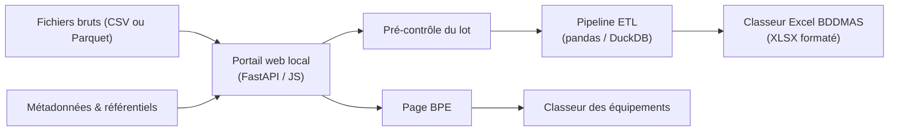

# Rapport d'Avancement du Projet — Portail BDDMAS
**Service SIG — Ville de Roubaix**  
*Date de mise à jour : 30 octobre 2026*

---

## 1. Présentation & Objectifs du Projet

Le projet **ApplicationMAJ (Portail BDDMAS)** fournit au Service SIG de la Ville de Roubaix une application web locale, simple d'utilisation et robuste pour :
* **Ingérer et contrôler** les fichiers de données infra-communales (recensement INSEE 2022 ou 2023, CAF, CNAM, DEFM, RPLS, fichier détail FD_INDCVI pour la petite enfance), en CSV ou en Parquet.
* **Rapprocher automatiquement** les fichiers de données de leurs métadonnées (`meta_*.csv`, `varmod_*.csv`) et des référentiels territoriaux (`Périmètres_MAS.csv`, `grand_quartier.yml`, superficies IRIS).
* **Exécuter le pipeline ETL** : transformation, jointures, calcul des indicateurs, règles d'arrondis (dont l'arrondi contrôlé des effectifs).
* **Générer le classeur Excel final** (Présentation, Portrait Roubaix, onglets thématiques mis en forme, Detail calcul).
* **Produire le classeur de la Base permanente des équipements** (BPE) pour Roubaix ou la MEL.

---

## 2. Architecture Technique

| Composant | Technologie | Rôle |
|---|---|---|
| **Lanceur** | `run_portal.bat` + `run_portal.py`, ou Docker (`docker compose up --build`) | Conversion des cubes du recensement puis démarrage du portail sur le port 5000 et ouverture du navigateur. |
| **Serveur** | FastAPI, Uvicorn, Python 3.11 ou plus | API des jobs (`/api/jobs`) : téléversement, pré-contrôle, génération en arrière-plan ; page `/bpe`. |
| **Moteur ETL** | `main_bddmas.py` + `modules/` | Lecture CSV/Parquet, filtrage Roubaix (`59512`), jointures IRIS, indicateurs, colonnes d'un nouveau millésime (`colonnes_auto.py`, IA facultative), export OpenPyXL. |
| **Interface** | HTML5, CSS3, JavaScript sans framework | Glisser-déposer, statut de chaque source, rapport de pré-contrôle, tableau des colonnes auto, page BPE. |
| **Identité visuelle** | Charte Ville de Roubaix | Logo institutionnel, magenta `#e3006a`, ardoise `#1e293b`. |

---

## 3. Réalisations

### A. Portail et lancement
* Lancement en un double-clic (`run_portal.bat`) ou avec Docker, sans Python sur le poste.
* Transformation automatique des cubes INSEE (2023 et suivants) au démarrage, sautée si les sorties sont à jour.
* Pré-contrôle bloquant : fichiers non reconnus, métadonnées manquantes, IRIS manquants ou inconnus, deux millésimes d'un même thème.

### B. Classeur BDDMAS
* Indépendant du millésime : recensement 2022 (format large) et 2023 (cubes convertis, fichiers complémentaires `DS_RP_…`).
* Pages Présentation et Detail calcul régénérées selon le lot ; onglet Portrait Roubaix en formules Excel.
* Trois colonnes de zonage (Mairies de quartiers, Grands quartiers, Libellé de l'Iris) ; mise en page aérée et réglable.
* Arrondi contrôlé : la somme des IRIS égale le total communal officiel (98 286 habitants en 2023).
* Onglets Filosofi 2021 retirés ; niveau de vie médian et taux de pauvreté de Roubaix gardés en valeurs figées dans le Portrait.

### C. Classeur BPE
* Fichier national ou filtré, CSV ou Parquet ; périmètre Roubaix (IRIS, quartiers) ou MEL (95 communes).
* Colonnes d'un nouveau millésime ajoutées ou laissées vides, et signalées sur la page.

---

## 4. Vérifications

Pas de suite de tests automatisés versionnée. Chaque évolution est vérifiée en relançant le pipeline sur les lots de `exemples/` et en comparant le classeur produit à la version validée, cellule par cellule. Le détail des vérifications de chaque session est dans `CONTEXTE_PROJET.md`.

---

## 5. Prochaines Étapes

* **Crèches** : trouver une source pour la colonne de l'onglet petite enfance (retirée tant qu'elle est vide).
* **IA hors poste mairie** : tester `scripts/simuler_nouveau_millesime.py` avec une clé, le réseau du bureau bloquant les API d'IA.
* **Chatbot du portail** : chantier séparé, même blocage réseau.
* **Filosofi** : mettre à jour les valeurs figées du Portrait Roubaix si un millésime plus récent paraît.
* **Agrégations multi-échelles** : onglets agrégés (quartiers, QPV / contrat de ville, centres sociaux), si le besoin est confirmé.
