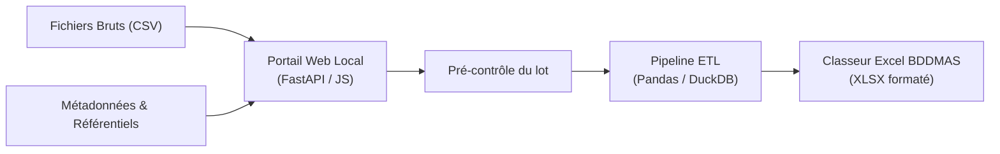
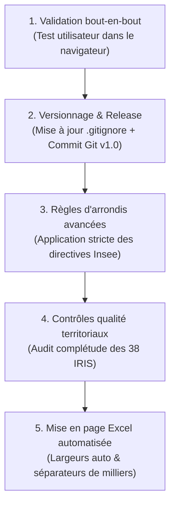

# Rapport d'Avancement du Projet — Portail BDDMAS
**Service SIG — Ville de Roubaix**  
*Date de mise à jour : 19 octobre 2026*

---

## 1. Présentation & Objectifs du Projet

Le projet **ApplicationMAJ (Portail BDDMAS)** a pour mission de fournir au Service SIG de la Mairie de Roubaix une application web locale, simple d'utilisation et robuste pour :
* **Ingérer et contrôler** les fichiers de données brutes infra-communales (recensement INSEE 2022, Filosofi, CAF, CNAM, DEFM, RPLS, microdonnées de la petite enfance).
* **Rapprocher automatiquement** les fichiers de données de leurs métadonnées associées (`meta_*.csv`, `varmod_*.csv`) et des référentiels territoriaux (`Périmètres_MAS.csv`, superficies IRIS).
* **Exécuter le pipeline ETL** de transformation, jointure, calcul d'indicateurs et application des règles d'arrondis.
* **Générer le classeur Excel final consolidé** (`TAB_BDDMAS_INSEE2022_Tout_perimetre.xlsx`) conforme au modèle normé SIG.



---

## 2. Architecture Technique

| Composant | Technologie | Rôle |
|---|---|---|
| **Lanceur système** | `run_portal.bat` + `run_portal.py` | Démarrage en un clic, gestion du virtualenv `.venv`, écoute sur le port 5000, supervision et ouverture automatique du navigateur. |
| **Serveur Backend** | FastAPI, Uvicorn, Python 3.14 | API REST pour la gestion des sessions de traitement (`/api/jobs`), téléversement, pré-contrôle et génération asynchrone en arrière-plan. |
| **Moteur ETL** | `main_bddmas.py` + modules | Ingestion DuckDB / Pandas, filtrage territorial strict sur Roubaix (`59512`), jointures géographiques IRIS, calculs d'indicateurs et export OpenPyXL. |
| **Interface Frontend** | HTML5, CSS3, JavaScript Vanilla | Application monopage sans dépendance externe lourde : drag & drop, suivi en temps réel de l'état des fichiers, barre de progression et visualisation du rapport. |
| **Identité Visuelle** | Charte Ville de Roubaix | Logo institutionnel officiel, signature couleur Framboise/Magenta (`#e3006a`) et thème ardoise (`#1e293b`). |

---

## 3. Bilan des Réalisations & Corrections Récentes

### A. Démarrage et Fiabilisation du Serveur
* **Correction du script batch (`run_portal.bat`)** :
  * Élimination de la fermeture intempestive de la fenêtre console.
  * Suppression du polling PowerShell `Test-NetConnection` qui polluait la console avec des alertes TCP répétées.
  * Suppression de l'ouverture en double du navigateur.
  * Lancement supervisé au premier plan avec maintien de la console en cas d'erreur (`pause` conditionnel).
* **Superviseur Python (`run_portal.py`)** :
  * Détection immédiate des arrêts prématurés de processus Uvicorn (évite d'attendre 30 secondes en cas d'erreur de port ou de dépendance).
  * Ouverture sécurisée du navigateur uniquement lorsque l'endpoint local répond avec un code HTTP 200.
  * Streaming direct et sans blocage des logs du serveur vers la console.

### B. Interface Utilisateur & Expérience Utilisateur
* **Correction des erreurs JavaScript bloquantes** :
  * Suppression de la `ReferenceError` liée à l'ancien bouton `dataDiplomesBtn` qui bloquait l'exécution du JS au chargement.
  * Nettoyage des balises HTML orphelines dans `index.html`.
* **Indicateurs d'import complets en temps réel** :
  * Affichage exhaustif des **13 fichiers de données** et des **12 fichiers de métadonnées attendus**.
  * Détection insensible à la casse, aux accents et aux préfixes (`base-ic-`, `BASE_TD_FILO_`, dates).
  * Les pastilles passent immédiatement de 🔴 (manquant) à ✅ (détecté) lors du glisser-déposer.
* **Barre de progression dynamique lors de l'analyse** :
  * Mesure du téléversement en temps réel avec pourcentage et volume envoyé (`ex: 45% (85 Mo / 190 Mo)`).
  * Transition fluide vers un état animé informant que le pré-contrôle serveur est en cours.
* **Intégration de la Charte Graphique Officielle** :
  * Intégration du logo institutionnel officiel de la Ville de Roubaix (texte blanc + chevron magenta).
  * Adoption de la couleur signature Magenta Roubaix (`#e3006a`) pour les boutons, onglets actifs et barres d'état.
  * Ajout du favicon sur l'onglet du navigateur et habillage professionnel de l'en-tête (*« VILLE DE ROUBAIX · DIRECTION DU SIG »*).

---

## 4. État des Tests Automatisés

Tous les tests d'intégration ont été exécutés avec succès dans l'environnement virtuel du projet :

```
[OK] GET / (Page d'accueil HTML valide, conteneurs dynamiques présents)
[OK] GET /static/styles.css (Feuille de style nettoyée, charte Roubaix)
[OK] GET /static/multi-upload.js (Script sans erreurs de référence, prédicats actifs)
[OK] GET /api/health (Service opérationnel)
[OK] POST /api/jobs (Rejet strict des formats non-CSV, code 400)
[OK] POST /api/jobs (Création d'un lot et exécution du pré-contrôle)
[OK] DELETE /api/jobs/{id} (Suppression propre et libération de l'espace disque)
```

---

## 5. Feuille de Route & Prochaines Étapes



### Priorité 1 : Validation Métier en Conditions Réelles
1. Ouvrir le portail via `run_portal.bat`.
2. Déposer l'ensemble des fichiers de données et métadonnées (vérifier que tout est au vert ✅).
3. Lancer l'analyse du lot (observer la barre de chargement et le rapport d'étape 02).
4. Cliquer sur **« Exécuter le pipeline ETL »** et vérifier la génération du classeur final.
5. Télécharger et inspecter le fichier `TAB_BDDMAS_Tout_perimetre.xlsx`.

### Priorité 2 : Gestion du Dépôt Git & Livrable
* Ajouter les fichiers générés (`*.xlsx` en dehors des modèles) au fichier `.gitignore`.
* Enregistrer les modifications dans un commit Git structuré :
  ```bash
  git add run_portal.bat run_portal.py web/
  git commit -m "feat(ui): intégration charte Roubaix, indicateurs en temps réel et fiabilisation du lanceur"
  ```
* Selon les directives du README, marquer la version stable avec un tag ou une release GitHub (`v1.0`).

### Priorité 3 : Évolutions Futures (Issues de la Boîte à Outils)
* **Arrondis stricts** : Harmoniser tous les calculs selon [`r_gles_d_arrondis_compl_tes.md`](file:///srvsig03p/Partage_SIG/Opendata/Alternants/Bilal%202026-2027/MAS/ApplicationMAJ/r_gles_d_arrondis_compl_tes.md) (entiers pour les personnes/ménages/logements, décimales pour les pourcentages RPLS, centimes pour les loyers).
* **Audit territorial IRIS** : Intégrer une vérification automatique de présence des 38 IRIS roubaisiens avant de démarrer le traitement lourd.
* **Agrégations multi-échelles** : Préparer de futurs onglets agrégés (Quartiers, QPV / Contrat de Ville, Centres sociaux).
